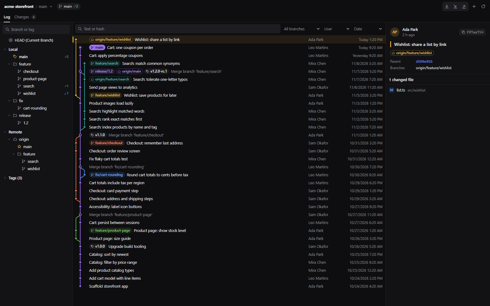
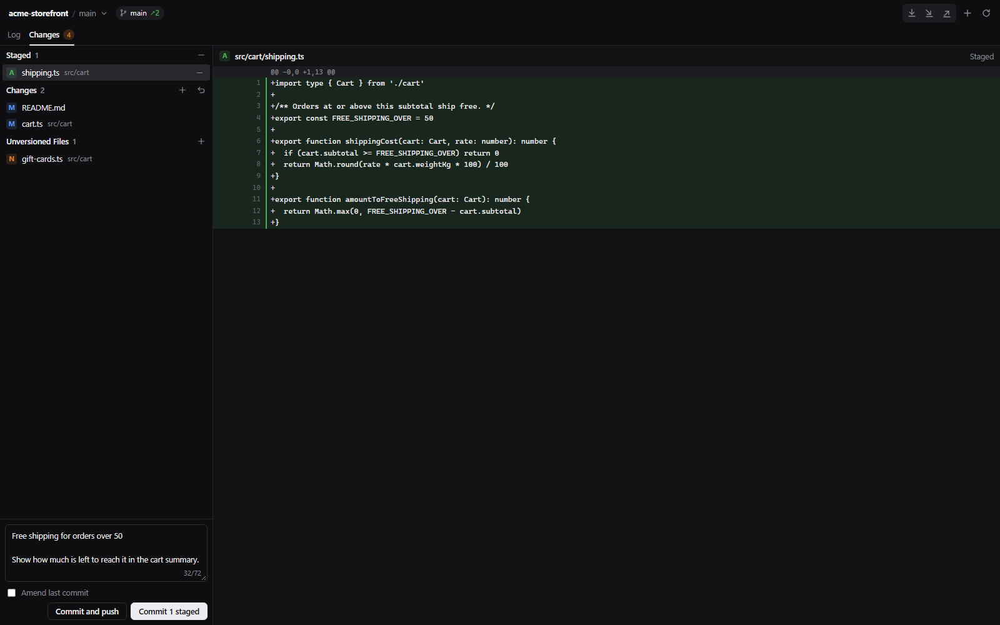
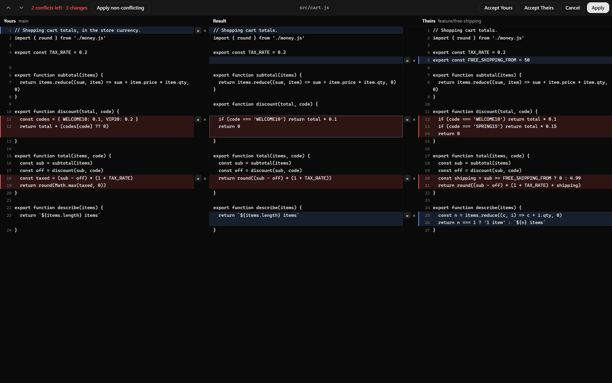
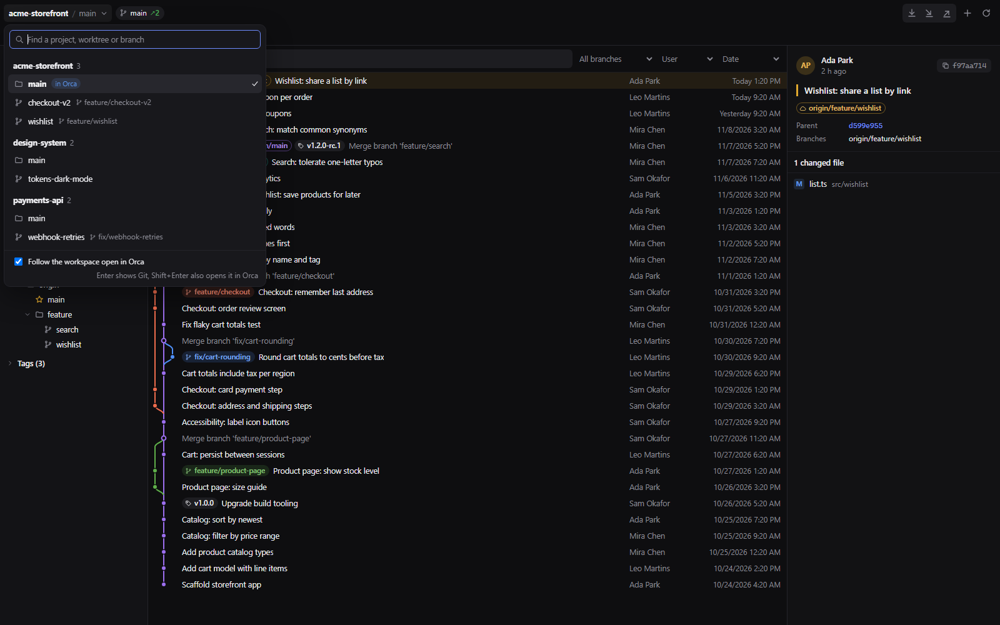
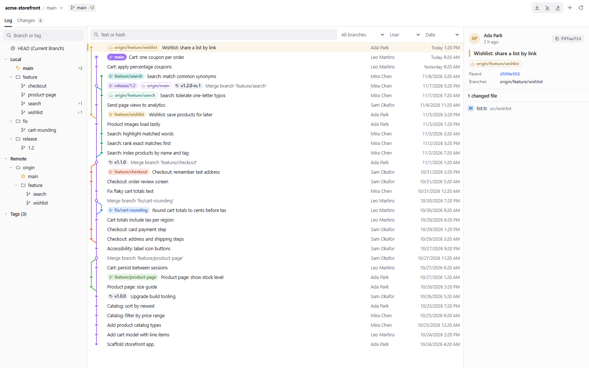

# Git Toolbox for Orca

A full Git panel for [Orca](https://github.com/stablyai/orca). See every branch as a commit graph, inspect
commits and diffs, stage and commit, resolve merge conflicts side by side, and switch between projects and worktrees without leaving Orca. It also keeps
the current branch and its incoming and outgoing commits in the status bar, in the spirit of
[GitToolBox](https://www.gittoolbox.com/).



## Install

```sh
orca plugin install serhii-f8/orca-GitToolBox
```

Orca shows what the plugin asks for before it runs (see [Permissions](#permissions)). The Git panel then appears in
the right sidebar under the branch icon.

## Features

### Log

- **Commit graph:** every branch in coloured lanes. Branch labels take the colour of their lane; the current branch is
  filled, remote branches are outlined and tags are grey. A local branch and its remote twin share one label
  (`origin & main`).
- **Filters:** text or hash, branch, author and date. Older commits load as you scroll; arrow keys move the selection.
- **Commit details:** author, message, branch labels, parents (click to jump) and the branches that contain the
  commit, then the changed files. Click a file for its diff.
- **Commit actions** (right-click): copy hash or message, check out the revision, new branch or tag, cherry-pick,
  revert, and reset the current branch (soft, mixed, keep or hard).

### Branches

- Local branches (current and favourites first, `/` names grouped into folders), remotes and tags.
- Incoming ↙ and outgoing ↗ commit counts against each branch's upstream; *gone* marks an upstream that was deleted.
- Click a branch to filter the log; double-click to check it out. The context menu has checkout, new branch, merge,
  rebase, update (fast-forward a branch that isn't checked out), push, rename, delete, favourites and "commits not in
  the current branch".
- Checkout offers to stash local changes when they would be overwritten.

### Changes



- Conflicts, staged, changed and new files, each with stage, unstage and roll back.
- A diff preview that stays open and updates in place while you work.
- Commit, amend, and commit and push (Ctrl/Cmd+Enter commits); the message box shows the subject length against 72
  characters.
- During a merge, rebase, cherry-pick or revert, a banner shows its state and offers to abort it.

### Merge conflicts



- When a pull, merge, rebase, cherry-pick, revert or stash pop stops on conflicts, the **Conflicts** dialog opens
  with every conflicted file. Pick one or more files and **Accept Yours** or **Accept Theirs**, or **Merge…** a file.
  The banner's *Resolve conflicts…* brings the dialog back; in Changes, double-click a conflicted file or use its
  context menu.
- **Merge view:** yours on the left, the result in the middle, theirs on the right, aligned chunk by chunk.
  Conflicts are red, changes made on one side only are blue. `»` / `«` take a side for a chunk (take both to keep
  both, in the order you click), `×` ignores it, and the result is plain text you can edit anywhere.
  *Apply non-conflicting* takes every one-sided change at once; F7 and Shift+F7 jump between conflicts.
- **Apply** saves and stages the file. It asks first if conflicts are left, and Cancel asks before throwing away
  your choices. If the file was edited by hand after the conflict, the view says so and can start from it.
- Pane headers name the sides: the branches of a merge, the upstream and your commit in a rebase, the picked
  commit in a cherry-pick.
- Binary, very large and deleted-on-one-side files are resolved whole, with Yours or Theirs.
- Once nothing is in conflict, the banner offers **Commit merge**, or **Continue** and **Skip this commit** for a
  rebase, cherry-pick or revert. After a stash pop it offers to drop the stash git kept.

### Projects and worktrees



- Click the project name in the toolbar, or press Ctrl/Cmd+K in the panel, to see every Orca workspace grouped under
  its repository. Type to filter; Enter shows that worktree's Git; Shift+Enter or the open button also opens it in
  Orca.
- With *Follow the workspace open in Orca* on (the default), the panel switches when you switch workspaces in Orca.
- The panel fits a narrow sidebar: the log sits above the details, and the branch tree opens from a button.

### Status bar, background fetch and commands

- **Status bar:** the current branch with ↑outgoing and ↓incoming counts and `*` for local changes. Click it to fetch.
- **Background fetch:** every 15 minutes by default, with a notification when the current branch falls behind.
- **Commands:** *Git Toolbox: Fetch*, *Update (Pull)* (`Mod+Shift+T`), *Push*, *Show Log*, *Show Changes* and
  *Switch Project or Worktree*.
- **Settings** (Settings → Plugins → Git Toolbox): fetch interval, status bar refresh, behind notifications, pull mode
  (merge, rebase or fast-forward only) and how many commits load per page.

Refreshes after actions, fetches and window focus happen in the background: only what changed is redrawn, and
scroll positions, the selected commit and open diffs stay put.



## Permissions

The plugin runs a Node worker on the Orca host that runs `git` in your workspaces. It asks for:

| Permission | Used for |
| --- | --- |
| `workspace:read` | Listing workspaces and following the one open in Orca |
| `workspace:write` | Opening a workspace in Orca from the switcher |
| `notifications:show` | "Branch is behind" after a background fetch |
| `storage:own` | Favourite branches |
| `settings:own` | The settings above |

## How it works

`worker/main.mjs` runs git and answers the panel (`panel/app.js`) over Orca's plugin requests. When Orca runs on
Windows and a workspace lives in WSL (`\\wsl.localhost\<distro>\...`), git runs inside the distro through
`wsl.exe --exec`, so it uses Linux git, its credentials and its speed. Conflict resolutions are written through git too
(the result is stored as a blob, staged and checked out), so line endings follow your git settings. Commit messages reach git through stdin, and
branch names typed in the panel are checked before they reach git.

## Development

```sh
npm test                          # parsers, graph layout, three-way merge, focus matching and real temporary repositories
orca plugin dev watch . --json    # on the Orca host (a Windows path for a folder in WSL)
```

Keep screenshots (`--shot <dir>`) outside the plugin folder: Orca ties a development plugin's approval to its files,
so writing into the folder pauses the plugin until it is approved again.

The screenshots in `media/` show a made-up demo repository.

## License

MIT
